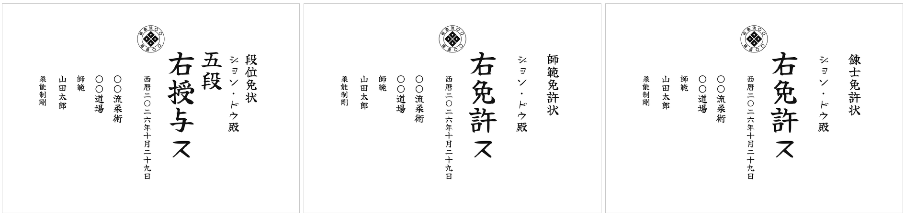

# menkyo-menjo-builder — Japanese dan and menkyo certificates

> [!NOTE]
> **Vibe coding warning.** Every line of code and documentation in this
> repository was generated by an AI model, with a human directing it and
> deciding what to keep. Read it as such: the code is workmanlike at best,
> the prose is more confident than the engineering behind it deserves, and
> nobody has reviewed it the way a maintained project would be reviewed.
>
> The certificates it produces, on the other hand, are real. They were
> designed carefully, checked against Japanese practice, and are printed and
> issued by an actual dōjō. If you are here for the documents rather than the
> software, that is the part to trust.

Generates print-ready dan-grade certificates (段位免状) and teaching licences
(免許状) for a martial-arts dōjō: A3 landscape, vertical Japanese, in the
manner of a traditional 賞状. The grade, the recipient and the date can each
be printed or left blank for a calligrapher to brush in.

<p align="center"></p>

<p align="center"><em>The three documents as an unconfigured build produces them.</em></p>

Everything that identifies a school lives in a TOML file. Out of the box the
generator names nobody: it prints 〇〇流柔術 and 〇〇道場 — the ordinary
Japanese placeholder — so an unconfigured build produces a correctly typeset
certificate that grants nothing.

## Quick start

```
uv run menkyo --list                 # what a default build would write
uv run menkyo                        # write it
```

Needs Python 3.11+ (for `tomllib`), Inkscape, and Pillow / NumPy / SciPy;
`uv run` installs the Python side. Without uv, `pip install -e .` and then
plain `menkyo`. From a checkout, files land in `build/` as
`<award>-<variant>.<ext>`.

## As a package

This repository is the generator and its `menkyo` command, and nothing else.
The front end is dojo-portal, a
separate Django application that runs the command in a subprocess.

Build the wheel from a checkout:

```
uv build --wheel                     # dist/menkyo-<version>-py3-none-any.whl
```

It holds the generator, its font, the example configuration and the `menkyo`
command. The consumer installs that file, for example as a uv path source or
with pip:

```
# from the consumer's project, next to this checkout
uv add ../menkyo-menjo-builder/dist/menkyo-<version>-py3-none-any.whl
pip install --force-reinstall ../menkyo-menjo-builder/dist/menkyo-<version>-py3-none-any.whl
```

The file name carries the version, so after a bump point the path source at
the new wheel. A rebuilt wheel of the same version needs a nudge: with uv,
run `uv lock --upgrade-package menkyo && uv sync`, because `uv.lock` pins the
wheel's hash (a plain `uv sync` stops on a hash mismatch); with pip,
`--force-reinstall` replaces it, which pip would otherwise skip. Or bump the
version for every build the consumer takes.

The version lives in `pyproject.toml` and nowhere else: bump it, commit, and
build the wheel again. `menkyo --version` reports which one is installed.

An installed copy has no checkout to sit in, so it writes to
`~/Documents/Menkyo` unless given `--out`, and reads a dōjō's settings from
`~/Library/Application Support/Menkyo/dojo.toml` (`~/.config/Menkyo/` on
Linux) when no `--config` is given.

Inkscape must be on the host as well. On Debian:
`apt-get install inkscape fontconfig fonts-noto-cjk` (the Noto fonts set the
crest ring).

Run it as a command, not as a library: the generator keeps its state in module
globals, and a render can take a couple of GB, which a separate process gives
back when it ends. Write the dōjō's settings to a TOML file
(`menkyo --example-config` prints the template), then:

```
menkyo --config=dojo.toml --awards=dan --variants=overlay --formats=pdf \
       --name=ヤン・ヤンセン --rank=二段 --date=2026-09-05 --out=/tmp/xyz --json
```

Pass every fill-in flag, `''` included, so a `[sample]` in the configuration
can never reach a real certificate, and use the `--flag=value` form so a value
that starts with `-` is not read as a flag. With `--json`, every line on
stdout is one JSON object, written as it happens:

| event | fields | when |
|---|---|---|
| `progress` | `step`, `total`, `award`, `variant`, `stage`, `label` | a slow step starts; `step` counts from 1 |
| `file` | `path` | a file has been written |
| `done` | `out`, `files` | the run finished; the exit code is 0 |
| `error` | `message`, optionally `detail` | the run failed; the exit code is 1 |
| `planned` | `file` | with `--list`: what would be written |

The command above writes, in part:

```
{"event": "progress", "step": 1, "total": 3, "award": "dan", "variant": "overlay", "stage": "text", "label": "dan overlay: rendering the text"}
{"event": "file", "path": "/tmp/xyz/dan-overlay-二段-ヤン-ヤンセン.pdf"}
{"event": "done", "out": "/tmp/xyz", "files": ["/tmp/xyz/dan-overlay-二段-ヤン-ヤンセン.pdf"]}
```

and a failure ends in one line such as
`{"event": "error", "message": "inkscape failed.", "detail": "…"}`.

`stage` is one of `text`, `ink`, `pdf` or `png`, for a caller that
wants its own wording; `label` says the same in English. `total` is known from
the first event, so `step / total` is a progress bar. A certificate takes
tens of seconds, most of it in `text` and `ink`. Without `--json`, the same
progress goes to stderr when that is a terminal, and stdout keeps its `wrote`
lines.

Every failure ends the output with exactly one `error`, a rejected flag or an
unwritable `--out` included, and never a `done`. `--list --json` writes one
`planned` per file and no `done`; its exit code says it worked. `--help`,
`--version` and `--example-config` print plain text even with `--json`: they
are for a person, and stop before anything runs.

## Configuring it for your dōjō

Copy the example and edit it:

```
uv run menkyo --example-config > dojo.toml
```

`dojo.toml` in the repository root is picked up automatically and is
git-ignored, so your school's identity never lands in a fork. `--config PATH`
chooses between several. A per-user `dojo.toml` (see "As a package") takes
precedence over the repository root's when it exists, in a checkout too.

```toml
[art]
name = "〇〇流柔術"          # the art, printed and on the crest's upper arc

[dojo]
name = "〇〇道場"            # the dōjō, printed below it
crest_ring = ""              # four characters on the crest's lower arc

[signer]
title = "師範"               # the office that grants the award
name = ""                    # the signatory, in katakana

[motto]
text = ""                    # an optional school precept, in its own column

[paper]
border = 22.0                # mm, the margin kept clear all round — see "Printing"
safe_inset = 38.0            # mm, where the text may begin
text_drop = 0.05              # fraction of page height — see "Where the columns start"

[[awards]]
slug = "dan"
heading = "段位免状"         # names the document
formula = "右授与ス"         # "the above is hereby awarded"
grade_column = true          # the body also states a grade: 初段, 二段 …
```

Each `[[awards]]` block becomes one `--awards` slug, so a school with a
different set of documents adds, removes or renames them here and nowhere
else. `grade_column` is the one subtle key: a dan certificate states a grade
in the body as well as in the heading, whereas a licence has already named
its award in the heading and would otherwise leave an empty column behind the
recipient's name. Setting it `false` closes the layout up.

A `colour` key, which earlier versions read for a drawn frame, is still
accepted and ignored: the certificates print in black on plain white paper.

### Where the columns start

`text_drop` shifts every printed column's starting point down by that
fraction of the page height, giving the reading order more air above it
without resizing or re-tuning anything. `0.05` is the shipped taste; `0`
reproduces the original layout, columns starting right under the crest.

It moves every column by the same amount, so a large value can push a tall
column past `safe_inset`. The one that matters is the date **left blank**:
its fourteen slots are the tallest column on the sheet, and at `0.05` it
still clears `safe_inset` by a few mm. Check with
`menkyo -v proof -d ''` before raising it further.

### An optional traced crest

The crest ring is set in a font by default, which is fine at 5 mm. If you have
your own crest and want its actual lettering, potrace each character to SVG,
drop them in a `crest/` folder beside your `dojo.toml`, named `安.svg`,
`心.svg` and so on, and set `traced_glyphs = true` under `[dojo]`.

Compare the two before you commit to it. Display lettering is usually drawn
already distorted to fit its arc, and tracing it puts a second arc on top of
the first — which is why this is off by default. `crest/` is git-ignored for
the same reason `dojo.toml` is.

The default mon is the yotsume-bishi, a traditional kamon; its proportions are
constants at the top of `src/menkyo/build_diploma.py`.

## Options

| flag | meaning |
|---|---|
| `-c`, `--config PATH` | which configuration to use (default: `dojo.toml`, else the shipped example) |
| `--example-config` | print the shipped example configuration and stop |
| `-a`, `--awards LIST` | which awards, or `all` (default: all) |
| `-v`, `--variants LIST` | which variants, or `all` (default: `overlay`) |
| `-f`, `--formats LIST` | `pdf`, `png`, `svg` (default: `pdf`) |
| `--no-ink` | solid black instead of graded sumi |
| `-n`, `--name KATAKANA` | print the recipient's name instead of leaving it blank |
| `-r`, `--rank GRADE` | print the grade: `2` or `nidan` → 二段, `1` → 初段, or literal text |
| `-d`, `--date YYYY-MM-DD` | print the award date in kanji; `today` also works |
| `--honorific TEXT` | appended to a printed name (default from the config; `''` to omit) |
| `--suffix TEXT` | tag for output filenames (defaults to the name) |
| `--dpi N` | resolution for PNG output (default: 300) |
| `--all` | shorthand for `--awards all --variants all` |
| `--clean` | empty `build/` first |
| `--list` | list what would be written, then stop |
| `--json` | one JSON object per line on stdout, for programs (see above) |
| `--version` | print the version and stop |

```
menkyo -a dan -r 5 -n 'ヤン・ヤンセン' -d 2024-07-01
menkyo -a dan -v proof -f png      # one proof sheet
menkyo --all -f pdf,png            # every variant, PDF and PNG
```

## Variants

| variant | what it is |
|---|---|
| `overlay` | the certificate, its text graded like sumi — **the one to print** |
| `overlay-flat` | solid black instead of graded sumi, pure vector |
| `proof` | safe areas and the zones the calligrapher fills |

Only `overlay` is built by default. All three are the same layout on plain
white paper. `overlay` and `overlay-flat` are black text and crest, with no
frame and no background; `proof` adds pale guides.

## Filling the document in

Three slots are normally left for the calligrapher — the grade, the recipient
and the date — and any of them can be printed instead.

`--rank` takes a number or romaji and writes the kanji: `2` or `nidan` becomes
二段, and `1` becomes **初段** — first dan has its own word, never 一段. Plain
numerals are used rather than the formal 弐段; pass the literal text if you
want the formal forms (`--rank 弐段`). Anything that is not a dan grade passes
through untouched, so a licence can use the same flag: `--rank 師範`.

`--date` takes an ISO date, or `today`, and writes 西暦二〇二六年九月五日: the
year digit by digit as 西暦 requires, month and day as spoken numbers (十二月,
三十一日). Leave it off and the column keeps an empty grid to brush into —
worth considering, since a sheet with the date already on it is one you cannot
hold back if a grading slips.

`--name` prints the recipient in katakana, in its own column between the
heading and the award, and moves the brushed rank slot left to make room. The
filename picks the name up so one recipient's files never overwrite another's.
Long names shrink to fit.

**How a Western name should be written in katakana is a judgement call.**
Dutch *Geert* could be ヘールト, ゲールト or フェールト — the hard G has no
Japanese equivalent and every choice is a compromise. Agree it with the
recipient before printing: it is the one word on the sheet they will look at
hardest.

## Printing

1. Plain white A3 paper.
2. Print `<award>-overlay.pdf` at **100 %** — no "fit to page", no scaling.
   The page is exactly 420 × 297 mm; check with a ruler on the first sheet.
3. `border` and `safe_inset` under `[paper]` are margins on that sheet:
   `border` is kept clear all round (22 mm by default), `safe_inset` is where
   the text may begin (38 mm). Nothing prints them; `-v proof` draws both, so
   you can check a layout against your printer's own unprintable edge.

**Print a `-flat` variant alongside your first real print.** The graded text is
a greyscale raster; a home laser halftones grey, and some printers mishandle
its transparency. If the 12 mm columns come out mottled, the `-flat` files are
the same layout in solid black, pure vector. Nothing else differs.

## How it looks the way it does

The printed text is set in **Yuji Boku** (佑字 木), a genuinely brush-written
kaisho, then graded by `src/menkyo/ink.py` so the ink thins toward grey where the
brush lifts — a real brush never lays down flat black. The font ships in
`src/menkyo/fonts/` and the build points fontconfig at it, so nothing needs installing and
nothing on your machine changes.

`DECISIONS.md` records why each line reads as it does, and how the ink was
arrived at.

## Layout

```
src/menkyo/             the package: everything the wheel ships
  build_diploma.py      generator and CLI; typography constants at the top
  config.py             the TOML configuration
  paths.py              where things live: checkout or installed, tools
  ink.py                the sumi grading
  example.toml          placeholder configuration, the shipped default
  fonts/                Yuji Boku + its OFL licence, used without installing
tests/                  the suite; tests/docker/ runs it with real renders
docs/                   templates explaining each document to the person
                        who receives it, plus the image above
build/                  generated; git-ignored
```

## Writing for the recipient

A certificate in a language its recipient cannot read is worth accompanying
with a page that says what it says. [`docs/`](docs/) holds one such page per
document, written for exactly that reader.

They explain in full everything the generator prints on its own — the
headings, the award and licence formulas, the date, 殿, the reading order, the
default crest. The four things that are configuration are described only as
far as the form goes, each marked with a block beginning **"If you are
adapting this document"**. Replace those with your own account: what your
crest means, what your school's name means, who signs. Nobody else can write
that part.

## A note on what this makes

This produces credentials. It is a typesetting tool and it will cheerfully set
any school's name in any grade — the placeholders exist so that it does not do
so by default, but they are placeholders and not a lock.

Awarding rank in a Japanese martial art is somebody's prerogative, and usually
not the prerogative of whoever has a printer. Configure it for the documents
you are actually entitled to issue.

## Licence

MIT — see [LICENSE](LICENSE). Two things are not covered by it: the bundled
font, which is under the SIL Open Font License, and crests and school names,
which are nobody's to grant. See [NOTICE](NOTICE).
